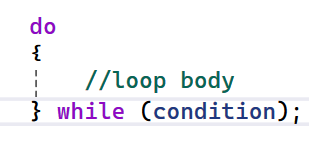
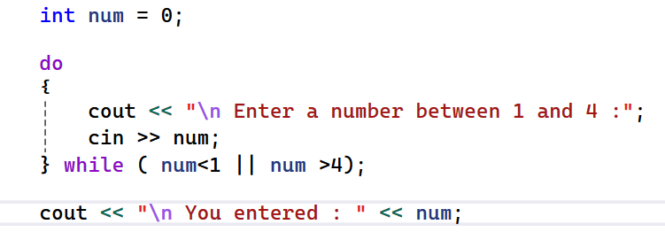
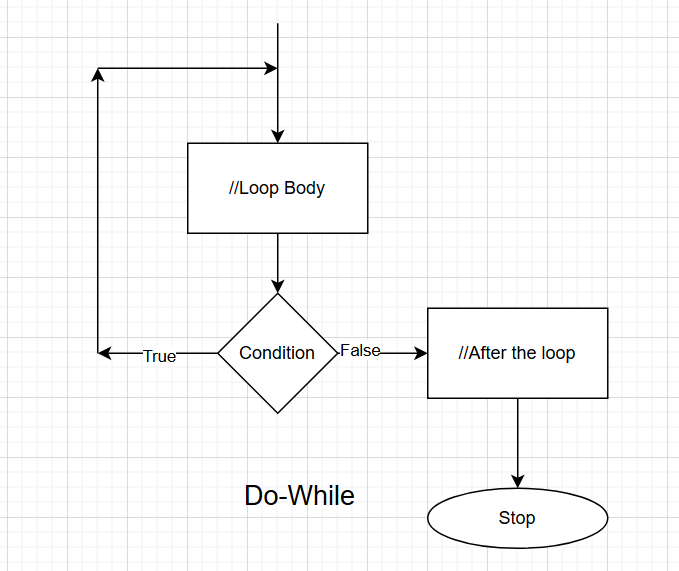
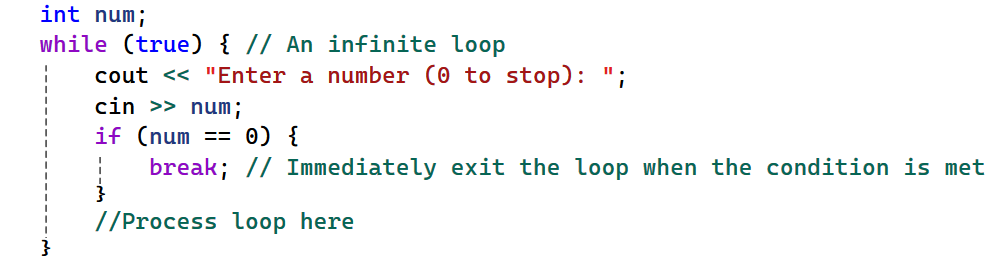
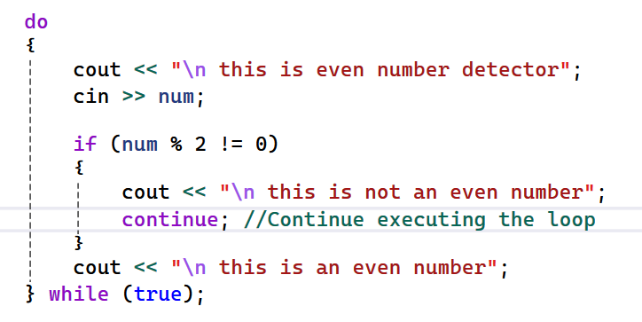

<!-- source-slide: 49; source-week: Week 7 -->
<!-- _class: content -->

# Decision Making at a glance

- Branching
  - If/else
    - slides 30 - 32
  - switch
  - goto
- Looping
  - while
    - slide 45
  - do/while
  - for
- Jumps in loops
  - break
  - continue

---

<!-- source-slide: 50; source-week: Week 7 -->
<!-- _class: content -->

# Do-while loop

- Do-while is an exit controlled loop
  - ( while is entry controlled)
  - When loop content should execute at least once
- E.g
  - Looping until user enters valid value
  - Gather game input for game loop

  

---

<!-- source-slide: 51; source-week: Week 7 -->
<!-- _class: content -->

# Do while : example

- Get a number between 1 and 4 from user.
  - Ask again if the numbers is not in range
  - Print the number and stop if it is in range.

  

---

<!-- source-slide: 52; source-week: Week 7 -->
<!-- _class: diagram -->

# While vs do-while,  visualized

  

---

<!-- source-slide: 53; source-week: Week 7 -->
<!-- _class: content -->

# Jumps in loops

- Break
  - Jump to after the end of loop
  - Loop does not execute
- Continue
  - Jump to the beginning of the loop
  - Loop continues to execute

  
  

---

<!-- source-slide: 54; source-week: Week 7 -->
<!-- _class: exercise compact -->

# Assignment 1: Create a menu driven calculator

- Enter 2 numbers
- Get user option ( 0 to 5) repeatedly
  - 1 -> add the two numbers and print
  - 2 -> subtract 2nd from first number and print
  - 3 -> multiply the two numbers and print
  - 4 ->divide 2nd by first number and print
  - 5 ->do nothing , and restart
  - 0 ->stop the loop
- Try using both loops and compare result
  - while
  - Do/while
- Use break and continue

---

<!-- source-slide: 55; source-week: Week 7 -->
<!-- _class: project challenge compact -->

# Boss Assignment: Menu driven multi purpose program

- Create a multi purpose program running until user enters 0
- Enter 2 numbers e.g. a, b;
- Get user options repeatedly and perform the operation
  - 1 -> find the least common multiple of 2 numbers
  - 2 -> find the highest common factor of the 2 numbers
  - 3 -> find ‘a' raised to the power of ‘b' using loops : ab
  - 4 -> find  1/ab using loops
  - 5 -> do something random from between 1 and 4
    - #include<cstdlib >
    - int rand = 1+ rand()%4;
  - 0 -> Exit the program
