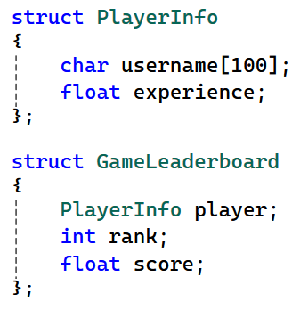
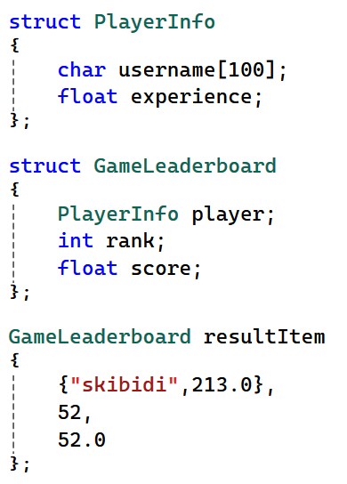
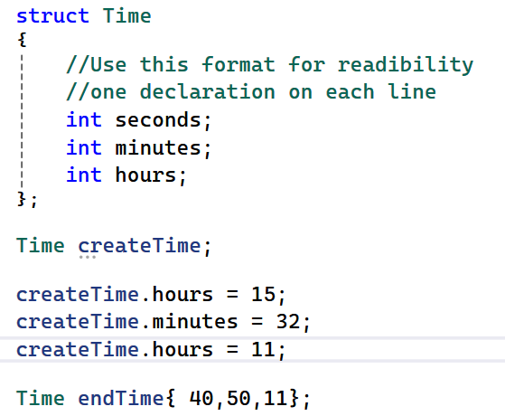

<!-- unit: structs -->

<!-- source-slide: 83 -->
<!-- _class: content -->

# Back to Data types

- Fundamental data type
  - int, char, float, bool, …
  - And arrays
- Custom data types
  - struct
    - Short for structure
  - class

---

<!-- source-slide: 84 -->
<!-- _class: content -->

# struct : use case

- Need for grouping multiple different types
- Helps organize complex data in a meaningful way
- Examples ….
  - time : seconds, minutes, hours
  - date : day, month, year
  - book : author, title, price, year
  - player : username, experience
  - game leaderboard : player, rank, score

---

<!-- source-slide: 85 -->
<!-- _class: content -->

# struct : definition

  

---

<!-- source-slide: 86 -->
<!-- _class: content -->

# struct : variable declaration

  

---

<!-- source-slide: 87 -->
<!-- _class: content -->

# Structure : member access using . operator

  

---

<!-- source-slide: 88 -->
<!-- _class: content -->

# Assingment

- Create a function to take a struct of PlayerInfo and print it.
- Create a function to
  - take 2 Time variables as parameters
  - Add them
  - And return the new Time
  - Hint
    - Time AddTime(Time timeA, Time time B){   //fill in here
    - }
