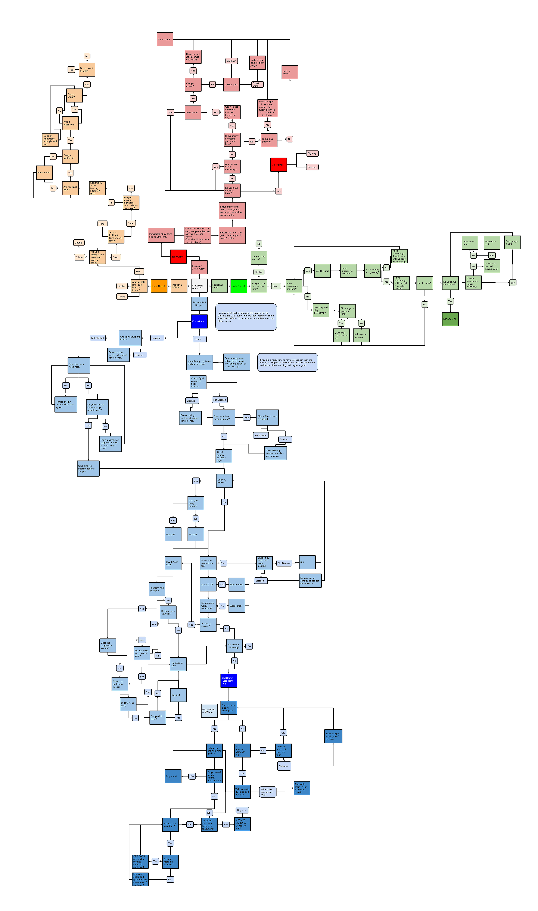
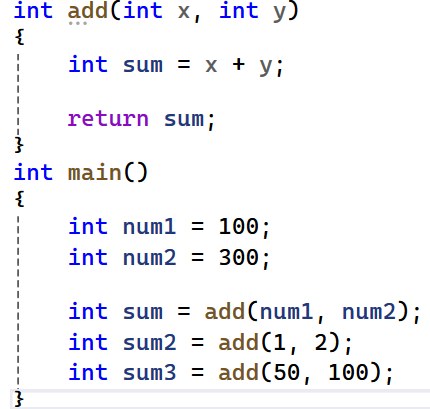
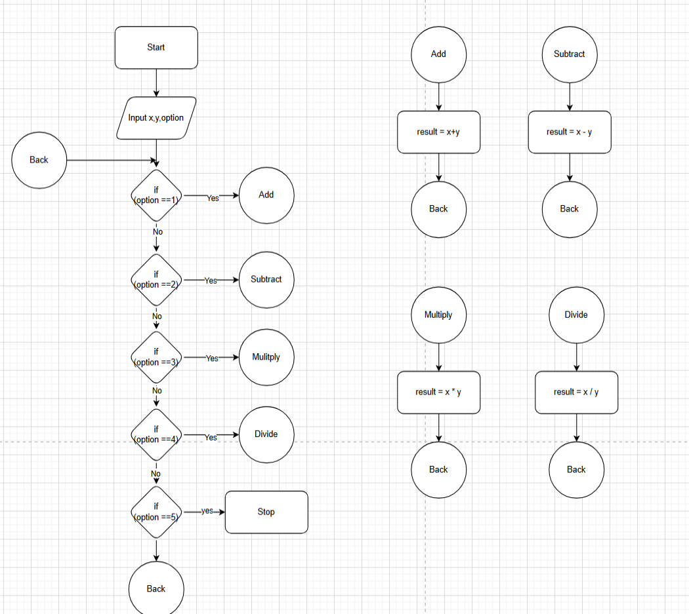

<!-- unit: functions -->

<!-- source-slide: 66; source-week: Week 9 -->
<!-- _class: content compact -->

# Reuse, organize, simplify code

- How would you …
  - Reuse the functionality that you have already implemented ?
  - Simplify your code that you can work on it independently
  - Organize your code for easy readability / maintainability …
- Best programming Tool
  - Functions
- Best Principle
  - DRY -> Don't Repeat Yourself ( i.e. in code )

---

<!-- source-slide: 67; source-week: Week 9 -->
<!-- _class: content -->

# Functions : Need

- How to do you make spaghetti ?
  - Write a big enough program
- Who/what is most popular in C/C++
  - The main function
    - Nothing happens without the main …
- Principle
  - Make spaghetti to eat but not in code.
  - Write a function , and it will be popular.

<div class="image-single">
  
</div>

---

<!-- source-slide: 68; source-week: Week 9 -->
<!-- _class: content -->

# Functions : How  ?

- Write a function
  - Once
- Use a function
  - Many times

<div class="image-single">
  
</div>

---

<!-- source-slide: 69; source-week: Week 9 -->
<!-- _class: exercise -->

# Lab : lets revisit calculator

- Create a calculator
  - Take 2 numbers from user  ( x, y)
  - Take options 1 to 4 from user
    - Based on option print the following (use functions)
      - 1-> x+y;
      - 2-> x-y;
      - 3-> x*y;
      - 4->x/y
      - 5 -> exit the program
      - (option <1 || option >5 ) -> "chose between 1 to 4"

---

<!-- source-slide: 70; source-week: Week 9 -->
<!-- _class: diagram -->

# Flowchart View

- Function ~ Circle
- Return ~ Back Circle
- Lets code this …

<div class="image-single">
  
</div>

---

<!-- source-slide: 71; source-week: Week 9 -->
<!-- _class: content -->

# Anatomy of a function

<div class="annotated-code">

```cpp
int add(int x, int y)
{
    int sum = x + y;
    return sum;
}
```

<dl>
  <dt>Return type</dt><dd><code>int</code></dd>
  <dt>Function name</dt><dd><code>add</code></dd>
  <dt>Parameters</dt><dd><code>int x, int y</code></dd>
  <dt>Function body</dt><dd>Statements between the braces</dd>
  <dt>Return statement</dt><dd><code>return sum;</code></dd>
</dl>
</div>

---

<!-- source-slide: 72; source-week: Week 9 -->
<!-- _class: content -->

# More function nuances

- Function don't have to return a value
  - Then must use "void" as return type.
    - void Print(int x) {..}
- Function can exist without  parameters
  - void Print(){..}
- Functions can call other functions  (nested functions)
  - Like main calls add
- A function can call itself (recursion)

---

<!-- source-slide: 73; source-week: Week 9 -->
<!-- _class: exercise compact -->

# Assignment

- Write a program to convert temperaturs
  - Celsius to Fahrenheit
  - and Fahrenheit to Celsius
- Use enters temperature and option
  - Option 1
    - Assume Celsius,  Convert to Fahrenheit
    - e.g. 0 -> 32
  - Option 2
    - Assume Fahrenheit,  Convert to Celsius
    - e.g. 180 ->100
- Formula
  - F  = C * (180/100) + 32
  - C = (F -32) * 100/180
- Must use functions

---

<!-- source-slide: 74; source-week: Week 9 -->
<!-- _class: project challenge compact -->

# Boss Assignment

- Fibonacci series : 0,1,1,2,3,5,8,13,21,34,55….
  - Starts with 0,1 and each number after is sum of previous 2 numbers
  - 0 + 1 ->  1
  - 1 + 1 ->  2
  - 8+13->21
- Task 1
  - Print nth number from Fibonacci series using functions
- Task 2
  - Print each Fibonacci number all the way to nth number
- Hints
  - Use functions
  - Use appropriate function parameters
  - Use recursive functions
